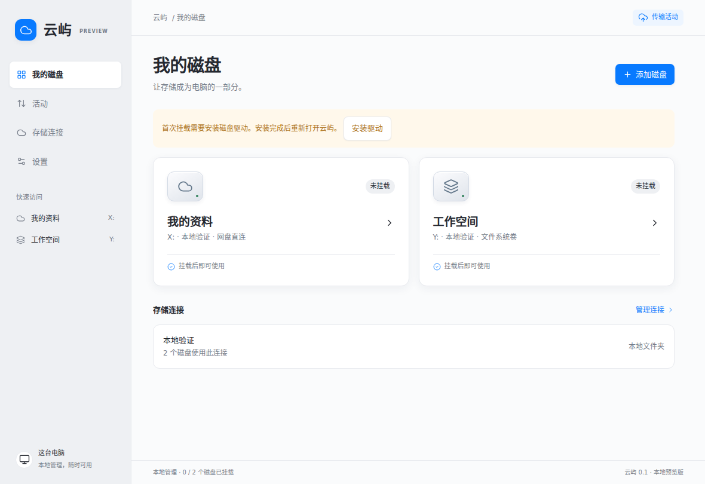

# OneMount

Windows 桌面存储管理器。统一管理账号、挂载、缓存与传输状态，用户不用执行命令或编辑底层配置。

当前为 **0.7.0 预览版**。产品名称统一为 OneMount。更新内容与使用边界见 [0.7.0 发布说明](docs/RELEASE-0.7.0.md)。



## 已实现

- **网盘直连**：内部 rclone 1.75.0 + WinFsp，完整读写缓存，文件关闭并空闲 5 秒后上传。
- **文件系统卷**：内部 JuiceFS 1.3.0，通过本机、需要认证的 S3 网关连接 rclone 后端。网关缓存关闭，避免双重异步写回；新建卷默认启用本地暂存与后台上传。
- 软件内连接本地文件夹、WebDAV、S3 兼容存储，检查连接与选择目录。
- 软件接管 OAuth 状态机、系统浏览器授权、问题选择、取消和超时。OneDrive、Google Drive、Dropbox 须先配置发布者自己的 OAuth 应用，才开放登录入口。
- 百度网盘：自定义开放平台后端，设备码授权，支持网盘直连和文件系统卷。能力、测试与额外上传临时空间见 [百度后端说明](engine-src/rclone/backend/baidu/README.md)。
- 每个磁盘独立缓存目录；文件系统卷使用独立远端前缀和本地 SQLite 元数据。
- 直连模式显示文件上传队列；文件系统卷显示待上传块数和字节数。未知状态不会显示成已上传。
- 安全卸载、托盘后台运行、启动时挂载、Windows 登录后启动。
- 账号配置加密，解密密码和网关认证信息由 Windows 当前账户加密保护。
- 关闭 JuiceFS usage 上报；初始化禁用更新检查；无应用遥测。

## 使用 Windows 软件包

1. 完整解压 Windows x64 软件包，双击 `OneMount.exe`。不需要安装 Node.js，也不需要单独下载两个引擎。
2. 如提示缺少磁盘驱动，点击「安装驱动」，从官方页面安装 WinFsp 后重启软件。它是系统驱动依赖，不包含在此便携包中。
3. 「存储连接 → 添加连接 → 本地文件夹」，选择一个空目录作为验证后端。
4. 「我的磁盘 → 添加磁盘」，分别创建网盘直连 X: 和文件系统卷 Y:，点击「挂载磁盘」。
5. 在资源管理器中新建、读取、修改文件；关闭文件，等待上传完成，点击「安全卸载」。再次挂载验证持久化。

**0.1.2 已通过真实 Windows + WinFsp 挂载与打包界面自动化验收，包括独立普通用户。** 本次环境为 Windows Server 2025（10.0.26100），后端为本地测试目录；未覆盖真实网盘 OAuth 或 Windows 10/11 逐版本验收，软件尚未代码签名。结果及边界见 [WINDOWS-VALIDATION.md](WINDOWS-VALIDATION.md)。

## 网络代理

在「设置 → 网络代理」选择连接方式：**直接连接（默认）**不使用应用层代理；**手动代理**使用填写的 HTTP、HTTPS 或 SOCKS5 地址（例如 `http://127.0.0.1:7892`）。不会自动继承启动环境中的代理变量。目前不支持带账号密码的代理地址。旧版的“默认连接”自动按直连处理，已保存的手动代理配置保留。

设置保存在本机，安全退出并重新打开OneMount后生效；已运行的挂载和上传不会被自动重启。代理应用于 rclone 的网盘挂载、连接检查、目录浏览和 OAuth 请求，覆盖所有网盘及文件系统卷的远端网关；本机控制接口和回环网关始终直连。系统浏览器以及百度设备授权请求不受此配置控制。

Google Drive 授权成功但连接或挂载超时时，可填写本机代理软件提供的地址，并保持代理软件运行。重新打开后，可先在存储连接中检查连接，再挂载磁盘。

## 传输活动与连接设置

「活动」页按连接展示最近 5 分钟的实际传输速度曲线，上方曲线、下方队列。每 3 秒采样，切换页面或最小化时仍在后台记录；历史只保存在本次运行的内存中。直连区分上传与下载，文件系统卷显示网关总传输。读取失败或采样中断时曲线留空，传输结束后归零；不提供独立测速。

「存储连接」选择连接后进入详情，点击整行修改名称、选择目录、检查连接、查看活动或移除连接。根目录显示为“根目录”。已用于磁盘的连接须先移除关联磁盘才能更换目录或移除连接，远端文件会保留。连接检查只读取目录，不写入文件，也不验证上传权限。

## 开发与构建

Windows 10/11 x64、Node.js 24、Go（工具链版本固定在 `engine-src/rclone/go.mod`）、PowerShell、系统自带 tar。

```powershell
npm ci
npm run engines:win
npm run install:electron
npm test
npm start
npm run package:win
```

便携软件输出到 `dist/OneMount-win32-x64/`。整个目录一起分发。两个引擎包含在 `resources/engines/`；rclone 从固定依赖的 Go 模块编译，JuiceFS 按固定版本及 SHA-256 下载。定制引擎的版本和校验记录保存在 `rclone-build.json`。Git 不保存大体积引擎二进制，避免超过 GitHub 单文件限制。

推送 main 或手动运行 GitHub Actions 后，可在成功的 `Windows preview build` 工作流的 Artifacts 中下载 `OneMount-Windows-x64-preview`。该工作流安装 WinFsp，执行真实挂载、PowerShell 读写、冷缓存重挂校验以及打包 EXE 界面测试；另以独立普通用户重复验收。所有门禁通过后才上传软件包，日志和界面截图在 `Windows-validation-evidence` 中。

## 自定义后端扩展

新后端统一放在 `engine-src/rclone/backend/<name>/`。构建自动生成导入并编译到定制 `rclone.exe`，不需要维护上游源码副本。接口、认证、测试和界面接入要求见 [后端扩展规范](engine-src/rclone/backend/README.md)。

```powershell
npm run engine:rclone:generate
npm run engine:rclone:test
npm run engine:rclone:build
```

## 自有品牌账号授权

### 控制展示哪些网盘

`provider-config.json` 独立控制允许新增的存储服务，不需要删除 OAuth 凭据。源码运行时读取项目根目录文件；便携包优先读取 `OneMount.exe` 同目录文件，缺失时读取包内默认配置。修改后安全退出并重新启动。

例如只提供百度网盘：

```json
{"enabledProviders": ["baidu"]}
```

支持的标识为 `onedrive`、`drive`（Google Drive）、`baidu`、`dropbox`、`webdav`、`s3`、`local`。不在列表里的服务不展示，也不能通过新增连接或新增磁盘接口绕过。空列表关闭全部新增入口；无效 JSON、未知标识和重复标识会报错，不会自动恢复全部开启。

入口开启后，仍需配齐该服务的登录凭据，否则显示「等待发布者开放登录」。已保存的连接和磁盘继续展示、使用和安全卸载，避免入口调整影响已有数据；这个配置用于产品入口控制，不是数据访问权限隔离。

构建工作副本中可设置 `ONEMOUNT_ENABLED_PROVIDERS=baidu`，再运行 `npm run release:config`；多个服务用逗号分隔。默认仅开放本地文件夹、WebDAV 和 S3 兼容存储。OneDrive、Google Drive、Dropbox、百度网盘需要显式加入允许列表，并配齐登录凭据；仅填写凭据不会自动开启入口。115 仍保留在独立开发分支，不在此配置支持范围内。

最终用户的流程是「添加服务 → 浏览器授权 → 选择目录」。不提供导入底层配置、执行命令行或显示原始配置问答的入口。

第三方授权页展示的应用名由 OAuth 注册决定。默认构建不使用 rclone 内置的公共 Client ID，避免授权页出现不属于本产品的名称。发布者应注册自己的桌面 OAuth 应用，把显示名设为 OneMount，配置相应权限与重定向地址。

1. 按 `oauth-clients.json` 格式新建 `oauth-clients.local.json`（已被 Git 忽略）。
2. 填写 `onedrive`、`drive`、`dropbox` 或 `baidu` 对应的 `clientId`、`clientSecret`；百度对应 AppKey / SecretKey。在构建工作副本的 `provider-config.json` 中加入要开放的服务，或设置 `ONEMOUNT_ENABLED_PROVIDERS`，再执行 `npm run release:config`。注意此命令会将私有配置写入 `oauth-clients.json`，不得提交含密钥的生成文件。
3. 执行打包。已开启入口但缺少凭据的服务会显示「等待发布者开放登录」；未开启的服务不显示入口。

也可通过 `ONEMOUNT_OAUTH_ONEDRIVE_CLIENT_ID` 等环境变量注入。桌面程序中的 Client Secret 可被提取，不能把它当成服务器端保密凭据；应按各厂商对本机应用的要求注册。回调使用内置引擎的本机回调端口 `53682`，常见 URI 为 `http://localhost:53682/`；具体提供商要求请以其官方注册指南为准。

授权控制由 `src/accounts.cjs` 实现，使用 `config/create` / `config/update` 非交互问答协议、异步任务和 `config/oauthstatus` / `config/oauthstop`。授权成功页已替换为本产品页面。真实第三方授权尚未在此环境验证，因为没有发布者 OAuth 应用与测试账号。

## 数据与生命周期

为兼容旧版，更名后默认数据仍在 `%APPDATA%/CloudIsland`，继续使用原有单实例锁；Windows 应用标识和远端 `.cloud-island` 前缀也保留，不迁移或新建已有卷的数据。账号密文、磁盘配置、元数据和缓存均保留在当前账户下。

账号连接诊断保存在同目录的 `auth.log`，每行是一条 JSON 记录，包含时间、连接尝试编号、阶段、任务结果及经过筛选的错误诊断（如微软 `AADSTS` 错误码、HTTP 状态和网络错误码）。取消连接或重启软件不会清除这些记录。单个文件最多约 1 MiB，保留 3 个轮转备份（`auth.log.1` 至 `auth.log.3`）。它不记录令牌、授权码、密码、完整授权地址、账号名称或原始服务响应；无法识别的错误记为 `unknown`，仍保留发生阶段。`accounts.log` 继续保存后台账号服务的进程日志。遇到“浏览器已返回，但连接失败”时，可从软件设置打开数据目录，查看最新的 `connection_failed` 记录。

- 直连：`rcd` → `mount/mount`；卸载前检查上传队列、缓存错误和脏缓存元信息，再调用 `mount/unmount`，最后退出后台进程。
- 文件系统卷：在所选连接内创建 `.cloud-island/<磁盘 ID>` → 启动独立 `serve s3` → 检查服务 → 初始化新卷并核对元数据身份 → 启动挂载。此目录必须先通过连接根目录创建，避免百度等后端无法创建网关根目录的上级目录。
- 初始化前保存进行中标记。网络检查失败后可以重试同一个磁盘，始终使用 `format --no-update`，核对卷名、存储类型和端点后才允许挂载；没有初始化标记的已有元数据不会自动接管。SQLite 数据库及 WAL 保持原位，绝不只移动或覆盖数据库主文件。
- 卸载执行 `umount --flush`，等挂载进程真正退出后才停止网关；失败时保留连接、会话、缓存和元数据。网关没有后台写缓存，上传成功响应必须等待后端完成。
- 每卷固定本机 S3 端口，重启保持一致。端口被占用时拒绝启动，不偷偷改写已格式化卷的地址。
- 意外退出后保留缓存与元数据。重新启动会尝试接管仍存活且能够通过认证的后台会话；不通过进程名批量终止程序。
- 移除磁盘只归档配置，不删除远端数据、元数据和缓存。没有「强制退出并删除缓存」按钮。
- Windows 挂载保留 JuiceFS/WinFsp 的当前用户默认映射，不传入自定义 `uidmap` 或不支持的 `--umask`。`--as-root` 只设置内部 POSIX 身份，不要求以 Windows 管理员身份运行主程序。

## 当前边界

- 仅面向 Windows x64 单机。SQLite 元数据不会自动在多台电脑之间共享或备份，不是分布式协调服务。
- `rclone serve s3` 上游仍为实验功能。此前 objbench 测试发现边界 Range、列表/marker 和 multipart 兼容问题；本项目验证的是常用块读写及重启回读链路，未宣称完整 S3 兼容或生产级可靠性。
- 安全卸载要求先关闭访问磁盘的程序。队列清空不能代表其他应用不再产生新写入，系统关机/断电无法保证尚在内存中的写入安全。
- 本版不提供跨设备一致性承诺、文件系统卷的文件级上传进度、手动缓存删除、共享卷或本地固定磁盘外观选项。
- 账号重新授权时先移除使用它的磁盘配置，再移除账号、重新连接。卷数据不会删除，恢复已归档卷目前需要开发者操作，尚无恢复向导。

## 验证与结构

`npm test`：配置校验、磁盘冲突、Windows 挂载参数、私有端点、未知状态、卸载队列保护、数据归档与 IPC 安全约束。

2026-10-19 的 OneMount 更名与入口配置验证：70 项自动测试全部通过；独立临时配置下的 5 项安装包检查通过，包括旧版与新版的单实例互斥、Windows 加密配置兼容、关闭服务后的接口限制、仅展示百度入口以及全部关闭时的空状态。安装包检查使用隐藏窗口 DOM 断言，未连接真实网盘或创建挂载；文件系统功能沿用 0.7.0 验证基线。可运行 `scripts/windows-provider-config-smoke.cjs` 复查，设置 `ONEMOUNT_PLAYWRIGHT`，可选 `ONEMOUNT_TEST_EXE` 和 `ONEMOUNT_PREVIOUS_EXE` 指定新旧安装包。

Linux 无 FUSE 的集成验证：

```bash
TEST_RCLONE=/absolute/rclone TEST_JUICEFS=/absolute/juicefs node scripts/integration.cjs
```

真实引擎测试覆盖加密账号配置、S3 账号接入、目录选择、初始化、六种大小/中文路径文件、网关重启、覆盖写入与删除后的 SHA-256 回读。记录见 [INTEGRATION-RESULTS.json](INTEGRATION-RESULTS.json)。

`scripts/ui-smoke.mjs` 是 Electron 自动化交互测试，依赖 Playwright，运行在无显示器的 Linux 测试容器中；测试专用临时 AES 密钥替代 Windows DPAPI，生产程序使用系统密钥保护。截图展示的是测试创建的未挂载磁盘，没有伪造在线状态或传输数据。

源码分工：`src/manager.cjs` 生命周期；`src/accounts.cjs` 账号；`src/plans.cjs` 参数；`src/processes.cjs` 子进程和本机控制接口；`src/main.cjs` 桌面和 IPC；`ui/` 产品界面。

应用源码 MIT；内置组件及图标版权见 [THIRD-PARTY-NOTICES.md](THIRD-PARTY-NOTICES.md)。

## 用网盘存放文件系统卷

在「我的磁盘 → 添加磁盘」选择「文件系统卷」，再选择已登录的百度网盘、OneDrive 或 Google Drive 连接。网盘保存 JuiceFS 数据块，文件名、目录、空文件和稀疏区域由本机元数据管理；因此百度的直连空文件限制不适用于此模式。网盘里原有的普通文件不会自动导入，不能通过网盘客户端直接编辑这些数据块。

新建卷默认开启「本地暂存与后台上传」，由 JuiceFS 将待上传数据保存在本机磁盘，再后台上传。可在「磁盘详情 → 缓存」调整开关与缓存容量；已有卷保留原设置，安全卸载后修改，下次挂载生效。如果上次异常退出后仍有待上传数据，必须先保持开启、挂载并完成上传，才能关闭。关闭此开关仍保留读取缓存。

本地暂存完成不代表云端已保存，仍需安全卸载。元数据、账号配置和未上传缓存都要保留；仅有网盘里的数据块不能直接恢复挂载。本分支不增加跨设备共享或恢复向导。

OneDrive 卷将同时上传的数据块限制为 1，减少慢响应下上传会话冲突。S3 网关为同一对象的 PUT/DELETE 提供进程内互斥，防止超时重试与旧请求的失败清理互相覆盖；删除块后保留空目录。补丁范围及回归测试见 [网关补丁说明](engine-src/rclone/patches/README.md)。

开发验证（Windows + WinFsp）：

```powershell
node scripts/windows-mount-integration.cjs
# 可选的真实网盘测试：需要已有授权，会在每个连接内新建独立测试卷。
$env:ONEMOUNT_LIVE_PROFILE = Join-Path $env:APPDATA 'CloudIsland'
& .\node_modules\electron\dist\electron.exe scripts/windows-cloud-volume-integration.cjs
# 界面测试需要 Playwright，可通过 ONEMOUNT_PLAYWRIGHT 指定已安装模块。
node scripts/windows-volume-ui-smoke.cjs
```

真实网盘测试默认覆盖百度、OneDrive、Google Drive，以及关闭/开启后台上传两种模式；可用 `ONEMOUNT_LIVE_TYPES=baidu,drive` 和 `ONEMOUNT_LIVE_WRITEBACK=0,1` 选择范围。测试使用复制的加密账号配置及独立盘符，不复用用户挂载；校验中文路径、跨块数据、随机写、追加、空文件、稀疏文件、截断、重命名、删除和两次冷缓存重启，最后检查远端数据块。报告、元数据、缓存备份均保留在被 Git 忽略的 `test-results/cloud-volume-*/`，远端测试卷也保留供核对。真实账号测试不会随 `npm test` 自动执行。

这套真实网盘测试按 `ONEMOUNT_LIVE_TYPES`（未设置时使用上述默认范围）为独立测试配置开放对应服务，冷重启时保持一致，不读取或修改产品的 `provider-config.json`。因此无需为运行测试更改发行版入口，但仍需各测试网盘已有授权。

本次验证记录见 [JuiceFS 网盘后端验证](docs/JUICEFS-CLOUD-VALIDATION-2026-10-14.md)。

文件系统测试基线保存在 [测试矩阵归档（Excel，2026-10-16）](docs/FILESYSTEM-TEST-MATRIX-2026-10-16.xlsx) 和 [当前清单（JSON）](docs/FILESYSTEM-TEST-MATRIX.json)。矩阵按 L1–L5、功能和用例来源分类，包含 364 条主清单，以及固定版本 JuiceFS 的 844 条静态测试目录和 71 个 CI 作业。Excel 保留补测前的 1004 条历史执行记录；JSON 已回填后续补测，共 1149 条执行记录。目录纳入不等于执行通过；失败、超时、跳过、待执行和不适用项分别保留，参数组合与断言不另外计作独立用例。

最新结论见 [2026-10-16 综合验证](docs/FILESYSTEM-VALIDATION-2026-10-16.md)：复用已有网盘、单元和界面测试，补测 37 个 WinFsp 可选入口、命令检查、应用负载及写缓存恢复。完整 Windows 文件语义仍有失败，不能视为文件系统完备性已获保证。

JuiceFS 卷现按 Windows 本地固定磁盘注册，见[本地磁盘变更与定向回归](docs/JUICEFS-LOCAL-DISK-VALIDATION-2026-10-16.md)。综合语义矩阵保留变更前的网络磁盘基准；本地盘模式已验证基本读写、缓存切换及安全卸载，完整上游语义尚未在新挂载类型下重跑。

运行方式见 [JuiceFS 官方 Windows 测试说明](docs/JUICEFS-UPSTREAM-TESTING.md)，结果见 [2026-10-14](docs/JUICEFS-UPSTREAM-VALIDATION-2026-10-14.md) 和 [2026-10-15](docs/JUICEFS-UPSTREAM-VALIDATION-2026-10-15.md)。已确认的截断一致性问题见 [根因与复现](docs/JUICEFS-TRUNCATE-INVESTIGATION-2026-10-15.md) 和 [后续版本核查](docs/JUICEFS-VERSION-CHECK-2026-10-16.md)，这些已知问题尚未在引擎中修复。
